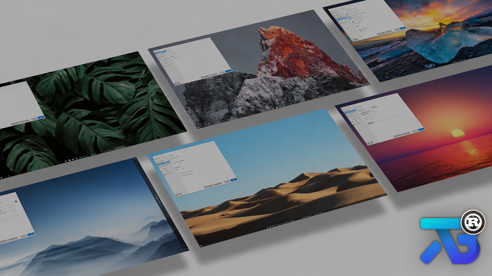

<p>
  
</p>

# TaskbarX-Rust

An **independent Rust rewrite of Chris Andriessen's [TaskbarX](https://github.com/ChrisAnd1998/TaskbarX)** for taskbar positioning and appearance. Not an official upstream release.

**v0.1.0 is an unsigned initial release**, targeting **native Windows 10 x64 with the classic Explorer taskbar only**.

## Downloads / quick start

- **Primary download — [taskbarx-configurator.exe](https://github.com/imafreakandyalldontknowit67/TaskbarX-Rust/releases/download/v0.1.0/taskbarx-configurator.exe):** the settings GUI and the file to open.
- **REQUIRED companion engine — [taskbarx.exe](https://github.com/imafreakandyalldontknowit67/TaskbarX-Rust/releases/download/v0.1.0/taskbarx.exe):** download this too; the configurator needs it to run TaskbarX.

**Download BOTH EXEs into the SAME stable folder, then launch `taskbarx-configurator.exe`.** See the [v0.1.0 release page](https://github.com/imafreakandyalldontknowit67/TaskbarX-Rust/releases/tag/v0.1.0).

This initial release is unsigned; keep Windows security checks enabled. Downloads require access while this repository is private.

1. Download both EXEs above into the same stable folder; no extraction is needed.
2. Open `taskbarx-configurator.exe`. Opening the GUI **does not start the engine**.
3. Select your settings and press **Apply** to save and start/restart the engine. **Save** only persists JSON; **Apply never enables startup**.

The direct downloads contain only the two EXEs, not `Open Settings.cmd`, sample files or packaged documentation. GitHub's automatic **Source code (zip)** and **Source code (tar.gz)** archives contain source, **not the ready-to-run application**. They are GitHub-generated and cannot be removed as uploaded release assets. [Locally generated packages](docs/USER-GUIDE.md#build-verify-and-package-locally) are separate from these release downloads.

Closing the GUI leaves the engine running. Use **Stop TaskbarX** to request graceful stop/restoration. Cleanup is not guaranteed after crashes or force termination, nor is exact restoration of every third-party effect. See the [user guide](docs/USER-GUIDE.md).

## Features

- Primary/secondary taskbar centering, signed offsets and centering between controls and tray.
- 42 easing choices, including instant positioning; configurable animation and polling.
- Transparent, transparent-gradient, blur, acrylic and opaque backgrounds, or Windows default.
- RGBA color, separate taskbar opacity, rounded corners, segments and Start/tray visibility.
- Battery overrides, fullscreen pause and resolution-based centering exceptions.
- Native settings GUI, read-only diagnostics, optional tray icon and explicit startup/shortcut actions.

See [settings and defaults](docs/USER-GUIDE.md#settings) and [behavioral safeguards](docs/USER-GUIDE.md#safety-and-behavior). Availability depends on the supported shell and successful measurements; this is not a visual-parity or performance claim.

## Windows compatibility

Modern Windows 11 taskbars are **unsupported**. Shell patching and elevation are not supported workarounds. Appearance APIs are build/theme dependent; avoid competing taskbar utilities.

Startup registration and status have been verified on Windows 10, including the account-name-to-SID fix. **Actual logon launch and most visual effects have not been live-tested.** Automated checks do not verify all features or restoration; see [verification scope](docs/USER-GUIDE.md#compatibility-and-evidence).

## Start icon files

Optional user-supplied `.ico` files can decorate Start-menu shortcuts; **pinning remains manual**. These icons are Chris Andriessen / upstream TaskbarX downloads, not bundled assets:

[start.ico](https://github.com/ChrisAnd1998/TaskbarX/releases/download/1.7.5.0/start.ico) · [startdark.ico](https://github.com/ChrisAnd1998/TaskbarX/releases/download/1.7.5.0/startdark.ico) · [startlight.ico](https://github.com/ChrisAnd1998/TaskbarX/releases/download/1.7.5.0/startlight.ico) · [startcolor.ico](https://github.com/ChrisAnd1998/TaskbarX/releases/download/1.7.5.0/startcolor.ico)

See [shortcut instructions and icon limitations](docs/USER-GUIDE.md#start-shortcuts-icons-and-shell-limitations).

## Commandline examples

From PowerShell in the folder containing both downloaded EXEs:

```powershell
.\taskbarx.exe --help
.\taskbarx.exe diagnose --json  # Read-only
.\taskbarx.exe run --primary-offset -20 --animation cubiceaseinout
# Run stays in the foreground; stop from another PowerShell window:
.\taskbarx.exe stop --timeout-ms 5000
```

`run` intentionally applies settings; its overrides are not saved. **Legacy flags such as `-tbs=1`, `-as=...` and `-stop` are unsupported.** See [all commands/options](docs/USER-GUIDE.md#commands).

## FAQ

**How do I start at sign-in?** Save your settings, then explicitly choose **Startup > Enable / update** using the saved configuration and selected delay (default **six seconds**). Editing the delay alone does not update registration. Save, Apply and `run` never register startup. **Disable / remove** removes only this rewrite's owned task.

**Where are settings stored?** `%APPDATA%\TaskbarX-Rust\settings.json`. Portable binaries do not imply portable settings; `--config PATH` selects another file.

**How do I update or remove it?** Stop first, preserve settings, and explicitly disable/update owned startup before moving executable/config paths. Close the GUI before replacing both EXEs or removing the folder. Remove owned shortcuts separately. Upstream tasks are **not** automatically migrated or removed. See [update/removal details](docs/USER-GUIDE.md#quick-use).

## Credits

Original TaskbarX by **Chris Andriessen**. **Copyright (c) 2021 Chris Andriessen**, preserved under the [MIT license](LICENSE); see [third-party notices](THIRD_PARTY_NOTICES.md).

Upstream ModernWPF, TaskScheduler and Emoji.Wpf references are .NET libraries, not this rewrite's Rust dependencies. Actual dependencies come from Cargo (including `clap`, `serde`, `serde_json` and `windows`); see [guide attribution](docs/USER-GUIDE.md#license-and-attribution).

The composite combines Chris Andriessen's upstream TaskbarX banner with an embedded Rust badge; it depicts upstream, not this build. Separate artwork rights require review before public distribution. Rust logo artwork is by Rust project contributors (CC BY 4.0); no Rust project or Foundation endorsement is implied. See [artwork provenance](docs/assets/README.md).
